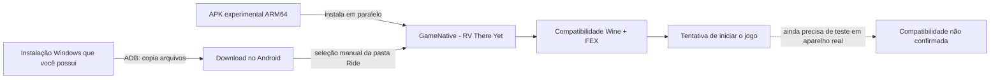

# GameNative + RV There Yet?

**Uma adaptação experimental do [GameNative](https://github.com/utkarshdalal/GameNative) para importar uma cópia local de RV There Yet? no Android.**

[](https://github.com/hitmau/GameNative-RV-There-Yet/tree/codex/rv-there-yet-offline-import)
[](https://developer.android.com/ndk/guides/abis)
[](LICENSE)

Esta branch prepara o GameNative para reconhecer a instalação Windows do jogo, escolher o executável correto e importar os arquivos locais. **Ainda não foi comprovado que RV There Yet? inicia ou funciona em um aparelho Android.**

<p align="center">
  
</p>

> A arte acima é promocional do GameNative. As imagens de RV There Yet? mais abaixo são da versão para PC, na página oficial do Steam; não são capturas do jogo rodando no Android.

## Situação atual

| Parte | Situação |
| --- | --- |
| Perfil Custom Game para reconhecer RV There Yet? | Implementado |
| Seleção automática do executável `Shipping` | Implementada |
| APK Android ARM64 de depuração | Compila; pode ser instalado em paralelo ao GameNative oficial |
| Cópia dos arquivos do PC para o Android via ADB | Script disponível; requer Depuração USB autorizada |
| Importação da pasta no app | Manual, pelo fluxo Custom Game |
| Inicialização, gráficos, controles e desempenho no celular | **Não verificados em aparelho real** |
| Login Steam no GameNative para importar a cópia local | Não necessário |
| Serviços/autenticação que o próprio jogo possa exigir | Não removidos nem verificados |

## Imagens do jogo

Capturas oficiais da edição para PC, exibidas aqui apenas para identificar o jogo e ilustrar o projeto.

<p align="center">
  
  
  
</p>

Fonte das capturas: [página oficial de RV There Yet? no Steam](https://store.steampowered.com/app/3949040/RV_There_Yet/).

## O que esta branch acrescenta

- Detecta a estrutura da versão para Windows por arquivos do jogo, incluindo o executável real e os arquivos IoStore `.ucas` e `.utoc`.
- Seleciona `Ride/Binaries/Win64/Ride-Win64-Shipping.exe`, em vez do pequeno `Ride.exe` que atua como inicializador.
- Cria uma variante Android separada, chamada **GameNative - RV There Yet**, com o identificador `app.gamenative.rvthereyet`.
- Oferece um script PowerShell que transfere a pasta do jogo por ADB, verifica o tamanho de arquivos importantes e instala o APK.
- Documenta a importação local e os limites conhecidos em [guia de instalação em Português (Brasil)](docs/RV-THERE-YET-OFFLINE-IMPORT-PT-BR.md).

O fluxo é:



## Instalação para teste

### Requisitos

- Windows com PowerShell e Android SDK Platform Tools (`adb`).
- Android ARM64 compatível, cabo USB e **Depuração USB** autorizada.
- Uma cópia legítima e completa do jogo no PC. O repositório não inclui arquivos do jogo.
- Espaço livre no telefone: o script estima **duas vezes o tamanho da instalação mais 5 GiB** para runtime. A importação cria uma cópia adicional; o cálculo é uma margem, não garantia.
- Internet na primeira execução, pois o GameNative pode baixar arquivos-base do runtime e componentes gráficos.

### Gerar o APK

Na raiz do repositório, execute:

```powershell
git submodule update --init --recursive
.\gradlew.bat :app:assembleModernRvthereyet
```

APK esperado:

```text
app/build/outputs/apk/modern/rvthereyet/app-modern-rvthereyet.apk
```

É uma compilação de depuração assinada localmente, destinada a teste. Este repositório não oferece um APK de release pronto nesta branch.

### Copiar o jogo e instalar o aplicativo

O padrão do script aponta para `D:\SteamLibrary\steamapps\common\Ride`. Para usar outro local, informe `-SourcePath`.

1. Conecte o celular, habilite Depuração USB e aceite a solicitação de autorização exibida no aparelho.
2. Confira a origem e o espaço necessário com a prévia:

   ```powershell
   .\tools\transfer_rv_there_yet.ps1 -SourcePath 'D:\SteamLibrary\steamapps\common\Ride' -WhatIf
   ```

3. Se a prévia estiver correta, transfira os arquivos e instale o APK:

   ```powershell
   .\tools\transfer_rv_there_yet.ps1 -SourcePath 'D:\SteamLibrary\steamapps\common\Ride'
   ```

4. No Android, abra **GameNative - RV There Yet**, acesse a biblioteca local, escolha **Custom Game** e selecione a pasta `Ride` copiada para `Download`.
5. Importe sem apagar a origem e tente iniciar o jogo. A importação pelo app e a primeira execução ainda precisam ser confirmadas no dispositivo.

Para apenas copiar os arquivos e instalar o APK manualmente, acrescente `-SkipAppInstall`. Consulte opções adicionais, como `-DeviceSerial` e `-RuntimeReserveGiB`, no [guia completo](docs/RV-THERE-YET-OFFLINE-IMPORT-PT-BR.md).

## Limites importantes

- O APK não contém o jogo, o runtime Wine nem o driver gráfico. O usuário fornece os arquivos da própria instalação e o app prepara dependências separadamente.
- A importação local evita entrar na conta Steam **no GameNative** para adicionar a pasta. Não elimina DRM, serviços Steam/EOS ou requisitos de rede do próprio jogo.
- A presença de DLLs Steam/EOS na instalação pode afetar login, recursos online e multiplayer. Esses recursos não foram testados.
- Requisitos de GPU listados para PC não predizem, por si só, compatibilidade ou desempenho no Android. Consulte os [requisitos oficiais](https://store.steampowered.com/app/3949040/RV_There_Yet/).
- O APK ARM64 e o perfil foram verificados no processo de desenvolvimento, mas a experiência completa — instalação no celular, importação, abertura, áudio, imagem, controles e FPS — depende de teste em dispositivo real.
- Este trabalho não traduz toda a interface do GameNative para Português (Brasil); o guia e este README estão em português.

## Relação com Skyrim Android

O projeto [Skyrim Android](https://github.com/ttom795/Skyrim_Android) serviu como referência para o fluxo de escolher uma pasta própria e conferir os arquivos antes de iniciar. A implementação técnica de Skyrim é específica daquele jogo e não é um runtime que possa ser reaproveitado para RV There Yet?. Esta branch não copia código nem arquivos de Skyrim.

## Projeto original, contribuição e licença

Esta é uma fork experimental de [GameNative](https://github.com/utkarshdalal/GameNative), cujo objetivo original é executar jogos de PC em dispositivos Android. As mudanças desta branch são uma adaptação comunitária e ainda não foram aceitas pelo projeto original.

O código segue a [licença GPL-3.0](LICENSE) e os avisos de terceiros em [THIRD_PARTY_NOTICES](THIRD_PARTY_NOTICES). Consulte também o repositório original para informações gerais, contribuições e suporte.

**Use apenas cópias de jogos que você tem direito de utilizar.** Nenhum conteúdo protegido de RV There Yet? é distribuído nesta fork.
